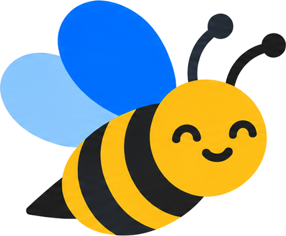
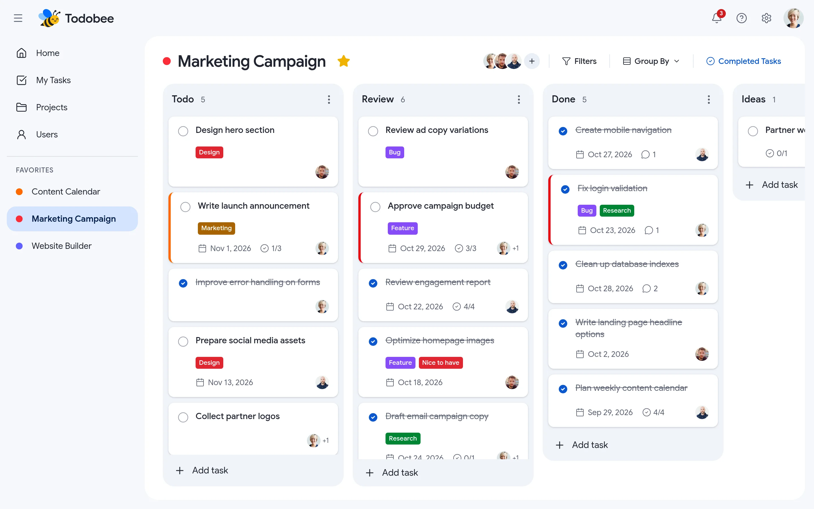

<p align="center">
  <a href="https://todobee.com" target="_blank">
  <picture>
    <source media="(prefers-color-scheme: dark)" srcset="./public/brand/bee-dark.png">
    
  </picture>
  </a>
</p>

<p align="center">
<a href="https://opensource.org/license/agpl-v3">
  
</a>
<a href="https://demo.todobee.com">
  
</a>
</p>

<div align="center">
  <strong>
    <a href="https://todobee.com">Todobee</a> is an open-source project management platform built for teams on Google Workspace.
      </strong>
</div>

<p align="center">
  <br />
  <a href="https://demo.todobee.com" rel="dofollow"><strong>Try the Live Demo »</strong></a>
  <br />

<p align="center">
  <a href="https://demo.todobee.com">Try Demo</a>
  ·
  <a href="https://todobee.com">Register</a>
  ·
  <a href="https://github.com/Sysfora/todobee/issues">Report an Issue</a><br />
</p>
<p align="center">
  <a href="#quick-start">Self-host Guide</a>
  ·
  <a href="#tech-stack">Tech Stack</a>
  ·
  <a href="#todobee-cloud-vs-open-source">Cloud vs Open-source</a>
</p>

<br />

<p align="center"><strong>Built for Google Workspace</strong></p>
<div class="flex" align="center">
  
  
  
  
  
  
</div>

<p align="center"><strong>Designed for high-productivity teams:</strong></p>
<div class="flex" align="center">
  
  
  
  
  
</div>

<br />

<p align="center">
  <a href="https://demo.todobee.com" target="_blank">
    
  </a>
</p>

<h2>✨ Features</h2>

<table>
  <tr>
    <td width="50%" valign="top">
      <strong>Clear Kanban Boards</strong>
      <br><br>
      <strong>Drag-and-drop cards between sections.</strong>
      Group any board by person, label, priority, or due date,
      and filter down to the exact work that matters right now.
    </td>
    <td width="50%" valign="top">
      <strong>All Tasks in One Place</strong>
      <br><br>
      <strong>Checklists, notes, files, priorities, and colored labels.</strong>
      Keep discussions, context, and attachments right on the task card.
    </td>
  </tr>
  <tr>
    <td width="50%" valign="top">
      <strong>Google Drive</strong>
      <br><br>
      <strong>Your workspace data belongs to you.</strong>
      Projects, tasks, notes, and files sync directly to a dedicated
      <code>Todobee</code> folder in the workspace admin's Google Drive.
    </td>
    <td width="50%" valign="top">
      <strong>Focused Team</strong>
      <br><br>
      <strong>Role-based visibility.</strong>
      Admins oversee the whole workspace; members see only assigned
      projects. Send invites by email and accept with Google.
    </td>
  </tr>
</table>

# Intro

- **Project Management on Google Workspace:** Native Google authentication and direct sync to the administrator's Google Drive.
- **Interactive Kanban Boards:** Fluid drag-and-drop organization across customizable columns and sections.
- **Rich Task Details:** Subtask checklists, markdown notes, file attachments, due dates, priority tiers, and color-coded labels.
- **Fast Local Caching:** Backed by PocketBase for sub-millisecond responses without hitting Drive rate limits on every interaction.
- **Email Notifications & Invites:** Seamless team onboarding via SMTP invitations and instant Google sign-in.
- **Flexible Subscription Model:** Built-in Stripe billing with per-seat licensing across Premium, Pro, and Enterprise tiers.

## Tech Stack

- **Next.js 16 (React 19)** - High-performance React application framework
- **Hono** - Fast and lightweight API server and gateway
- **PocketBase** - Real-time accounts, RBAC, invites, subscription state, and Drive cache
- **Google Drive API** - Secure persistence of project assets and attachments
- **Stripe** - Seat-based subscription checkout, billing portal, and webhooks
- **Tailwind CSS 4 & Radix UI** - Modern accessible styling and component primitives
- **Docker & Docker Compose** - Containerized deployment for app and demo environments

## Quick Start

To have the project up and running locally, please follow the steps below:

### 1. Prerequisites
- **Node.js 20+** and npm
- A hosted **PocketBase** instance (e.g. PocketHost, Fly.io, or self-hosted)
- A **Google Cloud** project with OAuth 2.0 Credentials and Google Drive API enabled
- *(Optional)* A **Stripe** account for recurring seat-based billing

### 2. Setup & Installation
```bash
# Clone the repository
git clone https://github.com/Sysfora/todobee.git
cd todobee

# Install dependencies for client and server
npm install

# Copy environment configuration
cp .env.example .env
```

### 3. Configure `.env`
Fill in your credentials in `.env` (refer to `.env.example` for details):
- `APP_URL=http://localhost:3000`
- `APP_SECRET=<your-random-32-char-string>`
- `PB_URL`, `PB_ADMIN_EMAIL`, `PB_ADMIN_PASSWORD`
- `GOOGLE_CLIENT_ID`, `GOOGLE_CLIENT_SECRET`
- *(Optional)* Stripe and SMTP credentials

### 4. Run Development Servers
```bash
npm run dev
```
Open [http://localhost:3000](http://localhost:3000) in your browser. The API gateway listens on port 4000.

### 5. Local Demo Mode (No Login / No Database Required)
```bash
npm run demo
```
Open [http://localhost:5000](http://localhost:5000) to explore the full interface with sample mock data.

### 6. Docker Deployment
```bash
docker compose up -d --build
```
| Port | What it serves |
|---|---|
| `3000` | Todobee production app (point your domain here) |
| `5000` | Todobee demo interface (e.g., `demo.todobee.com`) |

## Sponsor Todobee

We offer options to support the ongoing open-source development of Todobee:
- **Donations:** Help us maintain the codebase and add features faster.
- **Corporate Sponsorship:** Get your company logo and backlink featured in the repository and documentation.

Contact us at [contact@sysfora.com](mailto:contact@sysfora.com) for sponsorship inquiries.

<br />
<br />

## Todobee Cloud vs. Open-source

Choose [Todobee Cloud](https://todobee.com/) for a fully managed experience, or deploy Todobee Open-source on your own infrastructure. Both provide the exact same core product and features.

We do not gate essential features or artificially restrict the open-source license.

| Area | Todobee Cloud | Todobee Open-source (self-hosted) |
|---|---|---|
| **Cost** | Subscription per seat, 14-day free trial | Free forever (AGPL-3.0); you pay only for your infrastructure |
| **Setup time** | Sign up and create your workspace in minutes | Deploy via Docker / VPS; configure PocketBase, Google OAuth, and env vars |
| **Hosting & data** | Fully managed cloud; workspace data saved to your Google Drive | Runs on your server; data stays entirely within your environment and Google Drive |
| **Google Cloud Setup** | Pre-approved, verified Google OAuth app ready to use | You create your own Google Cloud OAuth Client and enable Google Drive API |
| **Projects & Boards** | Unlimited | Unlimited |
| **Tasks, Checklists & Labels** | Unlimited | Unlimited |
| **Google Drive Sync** | Automated background sync and cache management | Automated background sync (configurable `DRIVE_SYNC_INTERVAL_MS`) |
| **Team members & Seats** | Per subscribed plan seats | Unlimited seats |
| **Email Notifications** | Managed out of the box | Requires your own SMTP credentials |
| **Dark Mode** | Included | Included |
| **Multiple Admins** | Available on Enterprise | Supported in codebase |
| **Billing & Stripe** | Handled automatically | Optional; configure your own Stripe keys and webhooks if needed |
| **Updates & maintenance** | Automatic, zero downtime | You pull new releases and manage updates yourself |
| **Backups & Security** | Managed infrastructure | Your responsibility |
| **Support** | Priority support via email | Community support on GitHub Issues and Discussions |
| **Source access & customization** | SaaS platform | Full source code, fork and modify freely under AGPL-3.0 |

<br />

## Todobee Compliance

- This GitHub repository contains the open-source, self-hosted edition of Todobee. Todobee is also available as a managed service at todobee.com.
- Todobee uses official Google OAuth 2.0 authentication flows.
- Todobee requests the restricted `drive.file` scope, meaning it can only create and access files that it creates within the dedicated `Todobee` folder. It never scans, reads, or accesses the rest of your Google Drive.
- Todobee does not sell or share user data with third parties.
- Workspace data remains under your organization's control in your administrator's Google Drive.

## License

This repository's source code is available under the [AGPL-3.0 license](LICENSE).
